  
  
  
  
  

<picture></picture>

 

<picture></picture>

> **Aztech Games** is an independent game studio from Türkiye, founded by **Atakan Naci Çakır**.
> We design, build and ship games end-to-end — from the first prototype to the store page —
> and we build the tools that make that journey faster for other developers too.

<table>
  <tr>
    <td width="25%" align="center">🕹️ <b>Mobile Games</b> Hyper-casual &amp; casual titles with publishers like <b>Rollic</b>, <b>Moonee</b> and <b>Lion Studios</b></td>
    <td width="25%" align="center">🧰 <b>Unity Tools</b> Editor tools, controllers &amp; art packs on the Asset Store</td>
    <td width="25%" align="center">🎓 <b>Academy</b> 1000+ hours of Unity, Blender &amp; game design training</td>
    <td width="25%" align="center">🤝 <b>Consulting</b> Game design &amp; technical workflow support for indie teams</td>
  </tr>
</table>

 

<picture></picture>

<table>
  <tr>
    <td width="33%" align="center"><h3>🧩 Dimension 2D/3D</h3>PUZZLE  <a href="https://apps.apple.com/us/app/dimension-2d-3d/id6720739158"><b>▶ PLAY</b></a></td>
    <td width="33%" align="center"><h3>🏃 Treadmill Challenge</h3>ARCADE  <a href="https://apps.apple.com/us/app/treadmill-challenge/id6642680370"><b>▶ PLAY</b></a></td>
    <td width="33%" align="center"><h3>💀 Die For Run</h3>RUNNER  <a href="https://apps.apple.com/us/app/die-for-run/id6505026456"><b>▶ PLAY</b></a></td>
  </tr>
  <tr>
    <td width="33%" align="center"><h3>🪙 Coin Smash ASMR</h3>ASMR  <a href="https://apps.apple.com/us/app/coin-smash-asmr/id1667389248"><b>▶ PLAY</b></a></td>
    <td width="33%" align="center"><h3>🌊 Against the Flood</h3>STRATEGY  <a href="https://apps.apple.com/us/app/against-the-flood/id1635296114"><b>▶ PLAY</b></a></td>
    <td width="33%" align="center"><h3>🏎️ Race 'N Fight</h3>RACING  <a href="https://apps.apple.com/us/app/race-n-fight/id1630626568"><b>▶ PLAY</b></a></td>
  </tr>
</table>

  <a href="https://apps.apple.com/us/developer/atakan-cakir/id1598734806"><b>🍎 All games on the App Store</b></a> &nbsp;·&nbsp;
  <a href="https://play.google.com/store/apps/developer?id=Aztech%20Games"><b>🤖 Google Play</b></a>

 

<picture></picture>

<table>
  <tr>
    <td width="33%" align="center"><h3>🦾 Character Controller PRO</h3>TOOL · READY-2-USE  <a href="https://assetstore.unity.com/packages/slug/375816"><b>🔗 GET IT</b></a></td>
    <td width="33%" align="center"><h3>🎧 Master Audio</h3>TOOL  <a href="https://assetstore.unity.com/packages/slug/312836"><b>🔗 GET IT</b></a></td>
    <td width="33%" align="center"><h3>🧭 Waypoint &amp; Pathfinding</h3>TOOL  <a href="https://assetstore.unity.com/packages/slug/307493"><b>🔗 GET IT</b></a></td>
  </tr>
  <tr>
    <td width="33%" align="center"><h3>🧊 Texture To Model (Voxel)</h3>TOOL  <a href="https://assetstore.unity.com/packages/slug/295603"><b>🔗 GET IT</b></a></td>
    <td width="33%" align="center"><h3>💎 Gems &amp; Crystals + Shaders</h3>3D  <a href="https://assetstore.unity.com/packages/slug/321526"><b>🔗 GET IT</b></a></td>
    <td width="33%" align="center"><h3>🪂 Plane Controller (Glider)</h3>TOOL · FREE  <a href="https://assetstore.unity.com/packages/slug/270737"><b>🔗 GET IT</b></a></td>
  </tr>
</table>

  <a href="https://assetstore.unity.com/publishers/68211"><b>🛒 Browse every asset on our publisher page</b></a>

  <picture></picture>

 

<picture></picture>

  Learn game development with us — courses for <b>universities</b>, <b>companies</b> and <b>individuals</b>, 
  plus free bootcamps on YouTube and Discord.

  <code>🎮 Unity Beginner</code>&nbsp;
  <code>🧱 Blender Beginner</code>&nbsp;
  <code>🧠 Game Design</code>&nbsp;
  <code>📈 Product Management</code>

  <a href="https://www.youtube.com/@AztechGames"><b>📺 Watch on YouTube</b></a> &nbsp;·&nbsp;
  <a href="https://aztechgames.notion.site/E-itim-f623e24b054442f59acb27b877e39df4"><b>📚 Course details</b></a> &nbsp;·&nbsp;
  <a href="https://discord.com/invite/XVmYMdcRA2"><b>💬 Join the Discord</b></a>

 

<picture></picture>

  Publishing, co-development, training or consulting — <b>player two, press start.</b>

  
  
  
  

 

<picture></picture>
